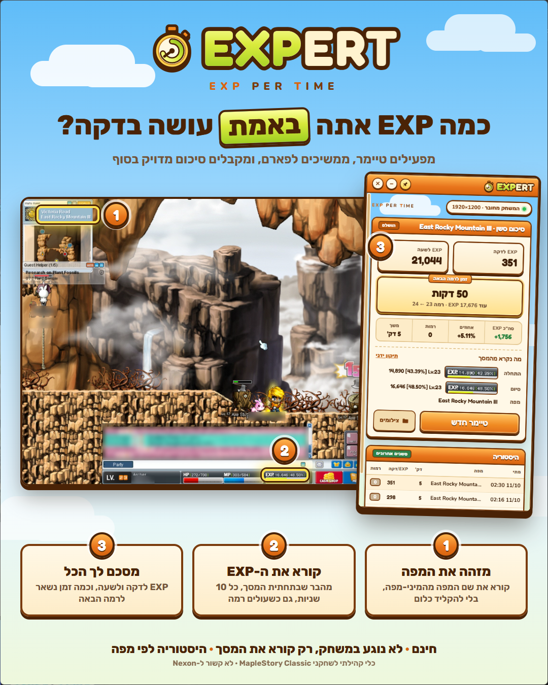

<div align="center">

# EXPERT
**EXP PER TIME**

A free farm timer for **MapleStory Classic** that reads your EXP straight from the screen
and tells you exactly how much EXP you make per minute, per hour, and how long until your next level.

[](https://github.com/oryanzz/EXPERT/actions/workflows/tests.yml)


[](LICENSE)

**English** · [עברית](README.he.md)



</div>

## What it does

Start a timer, keep farming, and get a precise summary when it ends:

- **EXP per minute** and **EXP per hour**
- **Time to your next level**, and how much EXP is left
- **The map** you farmed, read automatically from the minimap
- **Level-ups mid-session** are counted correctly
- **History** of every session, so you can compare maps (also saved as `history.csv` for Excel)
- Start and end **screenshots** kept as proof, plus a manual fix if OCR ever misreads a number

## How it works

EXPERT finds the MapleStory window, takes a screenshot of it every 10 seconds, and reads
two things with on-device OCR ([RapidOCR](https://github.com/RapidAI/RapidOCR)):

1. the **EXP bar** at the bottom of the screen (`EXP. 16,646 [48.50%]`) and your level,
2. the **map name** in the minimap header.

From the readings it adds up the EXP you gained - including across level-ups - and works out
your rates and time to level.

### Fair play

EXPERT **only looks at the screen**, exactly like a screen recorder or streaming software does.
It does **not** read or modify game memory, inject anything into the game, send keyboard or
mouse input, or automate gameplay in any way. Still, it is your responsibility to follow the
game's terms of service - see the [disclaimer](#disclaimer).

## Requirements

- Windows 10 or 11
- MapleStory Classic running **in windowed mode**, with the EXP bar visible
  (open the minimap if you want the map detected)
- Python **3.11 or 3.12** - `setup.bat` tells you how to get it if it's missing

## Install

1. Download the latest version from **[Releases](https://github.com/oryanzz/EXPERT/releases)**
   (`Source code (zip)`) and extract it, or `git clone https://github.com/oryanzz/EXPERT.git`.
2. Double-click **`setup.bat`**. It creates a private Python environment, installs the
   dependencies and adds an **EXPERT** shortcut to your desktop.
   - No Python yet? Run `winget install Python.Python.3.12` (or install it from
     [python.org](https://www.python.org/downloads/)) and run `setup.bat` again.
3. Start EXPERT from the desktop shortcut (or `run.bat`).

## Use

> The interface is in Hebrew for now (button names are given below). Translations are welcome!

1. Open the game in windowed mode. EXPERT opens beside it.
2. Click **Screen-read check** (`בדיקת קריאה מהמסך`) to confirm it reads your EXP and map correctly.
3. Pick the minutes and press **Start timer** (`התחל טיימר`). You get 3 seconds to switch back to the game.
4. While it runs you see a live EXP/min. When the time is up you hear a chime and get the summary.

Tips:

- **Don't cover the EXP bar** with another window - EXPERT skips that reading and tells you.
- Drag the window by its orange title bar. The pin button keeps it above other windows.
- If a number or the map name was misread, use **Manual fix** (`תיקון ידני`) in the summary.
  A corrected map name is remembered, so the same map is always written the same way.

### Your own end sound

Put any WAV file at `sounds/done.wav` and EXPERT plays it instead of the built-in chime.
(The original game sounds belong to NEXON, so they are not included - you can record one
for personal use, e.g. with Audacity's *Windows WASAPI* loopback recording.)

## Troubleshooting

| Problem | Fix |
|---|---|
| "MapleStory is not open" | Start the game first; EXPERT looks for its window. |
| "Another window is covering the EXP bar" | Move the other window (or EXPERT) off the bottom of the game. |
| Black screenshot | Switch the game from full screen to windowed mode. |
| Map not detected | Open the minimap in the game, or type the map in **Manual fix**. |
| Something else | Check `app.log` in the EXPERT folder and [open an issue](https://github.com/oryanzz/EXPERT/issues). |

## Privacy

- Everything stays **on your computer**: screenshots (`shots/`), history (`history.csv`) and
  settings. EXPERT has no accounts, telemetry, or analytics and uploads nothing.
- The only network request is loading the UI fonts from Google Fonts when you are online.
- Screenshots can show other players' names and chat - think twice before sharing them.

## Development

```bash
python -m venv .venv
.venv\Scripts\python -m pip install -r requirements-dev.txt
.venv\Scripts\python -m pytest
```

```
app.py              window, session runner and the API the UI calls
maple_exp/          capture, OCR, parsing, EXP math (tracker), minimap names, history
ui/                 the interface (HTML/CSS/JS)
tests/              unit tests + real-OCR tests on a sanitized screenshot
dev/                end-to-end harness, debugging probes, icon/sound/marketing generators
```

`dev/harness.py` drives the real app against a running game and screenshots every screen.
See [CONTRIBUTING.md](CONTRIBUTING.md) before opening a pull request.

## Credits

Created by **ORYANZ**.

- OCR by [RapidOCR](https://github.com/RapidAI/RapidOCR) with [PaddleOCR](https://github.com/PaddlePaddle/PaddleOCR) models
- Window by [pywebview](https://github.com/r0x0r/pywebview)
- Fonts: Fredoka, Nunito, Rubik (SIL OFL)
- Visual style inspired by [MesoWatch](https://meso.watch/)

Full list in [THIRD_PARTY_NOTICES.md](THIRD_PARTY_NOTICES.md).

## License

[MIT](LICENSE) © 2026 ORYANZ - free to use, modify and share; keep the copyright notice.

## Disclaimer

EXPERT is an independent, free, open-source fan project. It is **not affiliated with, endorsed
by, or sponsored by NEXON**. MapleStory is a registered trademark of NEXON Korea Corporation;
all game content and screenshots belong to their respective owners and appear here only to show
how the tool works.

The software is provided "as is", without warranty of any kind. You use it at your own risk and
are responsible for complying with the game's terms of service. The authors are not liable for
any damage, data loss, or account action resulting from its use.
